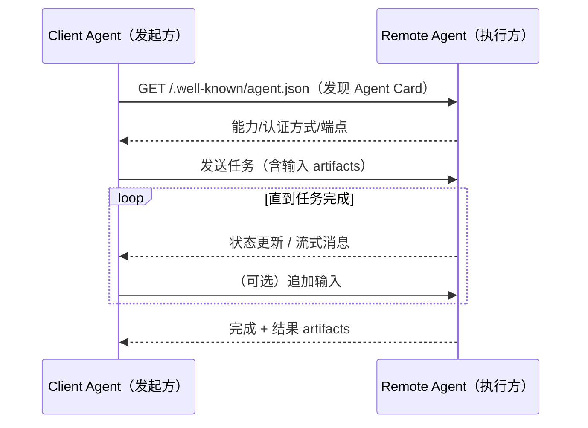

<FreshnessBadge />

# A2A（Agent2Agent Protocol）

## 一句话理解

A2A 是 Google 2025-04 发布、现由 Linux 基金会治理的**「agent 连 agent」开放标准**：让不同厂商、不同框架构建的 agent 能互相发现、验证身份、协商任务并交换结果。

## 解决什么问题

MCP 解决了 agent 用工具，但跨组织的 agent 协作（我的采购 agent 对接你的供应商 agent）此前没有公共语言——每对集成都要私约。A2A 提供标准化的互操作层，目标类比「agent 互联网的 HTTP」。

## 核心概念

- **Agent Card**：agent 的自描述文件（能力、端点、认证），`.well-known` 路径标准化发现；
- **Task 生命周期**：任务有状态机（submitted/working/completed…），支持长任务、流式更新与人工介入；
- **与 MCP 的分工**：A2A 管 agent 间协作，agent 自己的工具仍走 MCP——官方定位是互补。

## 采用情况

微软、Salesforce、SAP 等数十家厂商表态支持；框架侧 LangGraph、CrewAI、Google ADK、Microsoft Agent Framework 均提供集成。当前落地最多的是企业内部跨部门 agent 互调，跨组织商用尚早。

## 时间线

<Timeline tag="multi-agent" />

## 站内关联

- [多智能体系统方向](/frontier/directions/multi-agent) ｜ [AGNTCY](/frontier/protocols/agntcy)

## 参考资料

- [A2A 官方文档](https://a2a-protocol.org/latest)
- [Google 发布公告](https://developers.googleblog.com/en/a2a-a-new-era-of-agent-interoperability/)
- [IBM: What is the A2A protocol?](https://www.ibm.com/think/topics/agent2agent-protocol)
