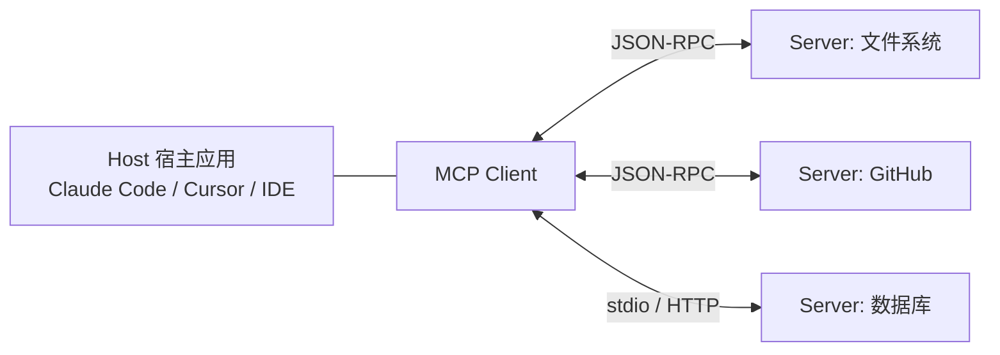

<FreshnessBadge />

# MCP（Model Context Protocol）

## 一句话理解

MCP 是 Anthropic 于 2024-11 开源的**「模型连工具」开放标准**：把工具/数据源做成独立的 server，任何宿主应用（Claude Code、Cursor、Codex……）都能即插即用——「AI 应用的 USB-C 接口」。

## 解决什么问题

此前每家应用 × 每个数据源都要写一遍定制集成（N×M 问题）。MCP 把它变成 N+M：应用实现一次 client，数据源实现一次 server，中间走标准协议。两年内生态爆发到 9800+ servers，成为事实标准。

## 架构

- **传输**：本地 stdio 或远程 HTTP（Streamable HTTP）；
- **三类能力**：`tools`（模型可调用的函数）、`resources`（可读数据）、`prompts`（预置提示模板）；
- **发现机制**：client 连上后列出能力，宿主把它们注入模型的工具列表——模型按普通 function calling 使用。

## 关键认知

1. **MCP 不改变模型行为**，只是工具分发格式；工具选择质量仍取决于模型与描述（见[工具使用](/learn/foundations/tool-use)）。
2. **安全责任在宿主**：装一个第三方 server 等于让它接触你的上下文与操作权限——供应链风险真实存在（见[安全](/learn/engineering/security)）。
3. **与 A2A 互补而非竞争**：MCP 连「agent ↔ 工具」，A2A 连「agent ↔ agent」。

## 时间线

<Timeline tag="tool-use" />

## 站内关联

- 精选 MCP server 目录：[生态-扩展](/ecosystem/extensions)
- [工具使用原理](/learn/foundations/tool-use)

## 参考资料

- [MCP 官方文档](https://modelcontextprotocol.io/)
- [官方参考 servers](https://github.com/modelcontextprotocol/servers)
