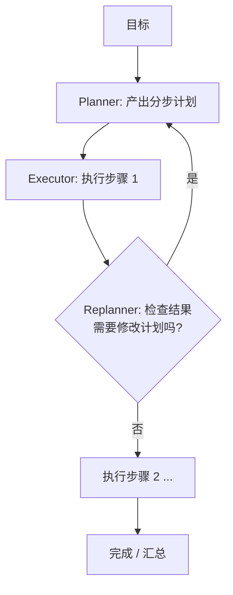

<FreshnessBadge />

# 推理与规划

## 一句话理解

推理解决「一步怎么想」，规划解决「多步怎么走」；agent 的智能 = 模型原生推理能力 × 你给它的规划脚手架。

## 为什么需要

LLM 直接输出答案时容易「想到哪说到哪」，复杂任务一步错步步错。把「想」和「做」拆开、给思考过程留出显式空间，是提升任务成功率的最低成本手段——这就是推理范式演进的主线。

## 范式演进

| 范式 | 年份 | 核心思想 | 一句话点评 |
| ---- | ---- | -------- | ---------- |
| CoT（思维链） | 2022 | 让模型「一步步想再答」 | 一切的基础，提示词一句话的事 |
| **ReAct** | 2022 | 思考→行动→观察 循环交替 | agent loop 的原型，至今仍是主流 |
| Self-Consistency | 2022 | 采样多条推理路径投票 | 换准确率的暴力但有效手段 |
| ToT（思维树） | 2023 | 推理建模为树搜索，可回溯 | 复杂规划强，成本高 |
| Reflexion | 2023 | 失败后语言化反思，下次改进 | agent 从错误中学习的代表 |
| Plan-and-Execute | 2023 | 先出全局计划，再逐步执行 | 长任务降低「走偏」概率 |
| 原生推理模型 | 2024- | o 系列/DeepSeek-R1 等，RL 训出长思考 | 正在吃掉外挂 CoT 脚手架 |

### ReAct 循环（必懂）

```
Thought: 我需要先搜索 MCP 的最新版本信息
Action: search("MCP latest release")
Observation: modelcontextprotocol 最新 release v1.2.0 ...
Thought: 信息够了，可以总结
Answer: ...
```

### Plan-and-Execute（长任务首选）



对比：ReAct 每步都重新思考全局，灵活但容易在长任务中「漂移」；Plan-and-Execute 先规划再执行，稳定但计划赶不上变化时需要 replan 机制兜底。LangGraph 的 Plan-and-Execute 模板是标准参考实现。

### 推理模型的冲击

o1/R1/Gemini-Thinking 这类原生推理模型把「慢慢想」内化进了模型。实践影响：

- 简单任务的外挂 CoT 提示（"let's think step by step"）收益急剧下降；
- agent 架构重心从「教模型怎么想」转向「给模型喂什么」（上下文工程）和「让模型能做什么」（工具与权限）；
- 但 ReAct 循环本身没过时——推理再强也需要行动与观察的接口。

## 我的实践笔记

- 规划脚手架的性价比排序：明确的任务描述 > 好的工具描述 > 复杂的提示技巧。
- 给 planner 的输出定 schema（JSON 步骤列表），比自由文本计划可控得多。

## 参考资料

- [ReAct](https://arxiv.org/abs/2210.03629) ｜ [Reflexion](https://arxiv.org/abs/2303.11366) ｜ [ToT](https://arxiv.org/abs/2305.10601)（均已录入 `data/papers.yml`）
- [LangGraph: Plan-and-Execute](https://langchain-ai.github.io/langgraph/tutorials/plan-and-execute/plan-and-execute/)
