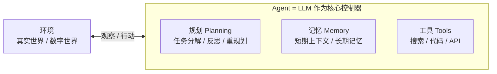

<FreshnessBadge />

# 什么是 Agent

## 一句话理解

Agent 就是一个**在循环里使用工具的 LLM**：接收目标 → 思考 → 调用工具 → 观察结果 → 继续思考，直到任务完成或需要人类介入。

## 为什么需要

单纯的 LLM 只能「一问一答」，能力被限制在它训练时见过的知识里。真实任务需要：查实时信息、操作数据库、读写文件、调用业务系统——这些都要**行动**。Agent 的本质突破是让模型从「回答者」变成「执行者」，代价是引入了不确定性，需要工程手段来约束。

## 核心原理

业界公认的三要素框架（源自 [Lilian Weng 的奠基长文](https://lilianweng.github.io/posts/2023-06-23-agent/)）：



**Agent 与 Workflow 的分界线**（[Anthropic 的定义](https://www.anthropic.com/research/building-effective-agents)）：

| | Workflow | Agent |
| --- | --- | --- |
| 控制流 | 代码预先编排好 LLM 调用顺序 | LLM 自己决定下一步做什么 |
| 灵活性 | 路径固定，可预测 | 路径动态，适应开放任务 |
| 成本/延迟 | 低且稳定 | 高且不可预测 |
| 适用 | 明确流程的任务（分类、提取、固定管线） | 开放式任务（研究、编码、复杂客服） |

> 实践忠告（Anthropic）：**能 workflow 就别 agent**。从最简单的方案开始，只在确实需要灵活性时才增加自主性。

## 一个最小 Agent Loop

```python
messages = [{"role": "user", "content": "帮我查一下 MCP 仓库最近的 release 并总结"}]
tools = [search_web, read_url, summarize]

while True:
    resp = llm(messages, tools=tools)          # 1. 思考
    if resp.tool_calls:                        # 2. 决定行动
        results = execute(resp.tool_calls)     # 3. 执行工具
        messages += observe(results)           # 4. 观察结果，回到 1
    else:
        print(resp.content)                    # 给出最终答案，退出循环
        break
```

真正生产级的 agent 还需要围绕这个循环加上：上下文管理（见[上下文工程](/learn/foundations/context-engineering)）、护栏（见[护栏与人机协同](/learn/patterns/guardrails)）、评测与追踪（见[评测](/learn/engineering/evaluation)）。

## 关键概念辨析

- **Agent ≠ Chatbot**：chatbot 单轮响应；agent 有目标、有状态、有多步行动。
- **Agent ≠ RPA**：RPA 按录制的脚本执行；agent 按理解的任务意图动态决策。
- **Agentic ≠ Autonomous**：agentic 指具备自主行动的*能力维度*（哪怕只自主一步）；fully autonomous 是自主程度的极限，生产中绝大多数 agent 都保留人类介入点。

## 我的实践笔记

- 判断一个场景该不该上 agent，先问：**这个任务的下一步取决于上一步的结果吗？** 如果路径能提前写死，用 workflow。
- demo 和生产的差距 90% 在循环之外：工具报错处理、上下文溢出、循环兜底（最大步数）。

## 参考资料

- [Lilian Weng: LLM Powered Autonomous Agents](https://lilianweng.github.io/posts/2023-06-23-agent/)
- [Anthropic: Building Effective Agents](https://www.anthropic.com/research/building-effective-agents)
- [OpenAI: A Practical Guide to Building Agents](https://cdn.openai.com/business-guides-and-resources/a-practical-guide-to-building-agents.pdf)
