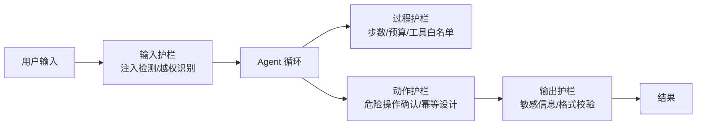

<FreshnessBadge />

# 护栏与人机协同

## 一句话理解

护栏是「在 agent 的自主性和安全之间画边界」的全部手段：从输入过滤、权限最小化，到关键动作前的人类确认（human-in-the-loop）。

## 为什么需要

Agent 与普通 LLM 应用的本质区别：**它能动真实世界**——发邮件、改数据库、下单支付。错误不再只是「说错话」，而是「做错事」，且循环会放大错误。自主性越高，护栏越重要。

## 护栏的四个层次



1. **输入护栏**：prompt injection 检测、任务合法性初筛（详见[安全](/learn/engineering/security)）。
2. **过程护栏**：最大步数、token/费用预算、工具调用白名单与频次限制、循环检测。
3. **动作护栏**：按风险分级——
   - 只读操作：直接放行；
   - 可逆写操作：执行 + 记录（审计日志）；
   - 不可逆操作（删除、支付、对外发送）：**human-in-the-loop 强制确认**，展示「我要做什么、为什么、影响范围」。
4. **输出护栏**：敏感数据脱敏、结构化结果校验（schema 校验失败自动重试）。

## Human-in-the-loop 的正确姿势

HITL 不是「每步都问人」（那叫向导），而是**在不可逆的关口暂停**：

```python
action = agent.propose_next_action()
if action.risk_level in ("irreversible", "external"):
    approved = ask_human(action.summary(), action.diff())
    if not approved:
        agent.observe_rejection(approved.reason)  # 拒绝原因喂回去，agent 能调整
        continue
execute(action)
```

设计要点：确认信息要**展示证据**（diff、引用、预览）而非抽象描述；拒绝时把理由回传给 agent，让它能换路径而不是卡死。

## 实现生态

- 框架层：OpenAI Agents SDK 内置 guardrails、LangGraph interrupt、各框架的 HITL 原语；
- 独立校验：类型化输出（Pydantic/Instructor）+ 规则引擎（LLM-as-judge 做语义级把关，见[评测](/learn/engineering/evaluation)）。

## 我的实践笔记

- 护栏配置应该数据化（每个工具标风险级别），而不是散在代码 if 里——评审和审计都容易。
- 「权限最小化」是最好的护栏：agent 的数据库账号只grant 它需要的表，比任何 prompt 约束都可靠。

## 参考资料

- [OpenAI: A Practical Guide to Building Agents](https://cdn.openai.com/business-guides-and-resources/a-practical-guide-to-building-agents.pdf)（guardrails 章节）
- [LangGraph Human-in-the-loop](https://langchain-ai.github.io/langgraph/concepts/human_in_the_loop/)
- 站内：[安全](/learn/engineering/security)、[评测](/learn/engineering/evaluation)
