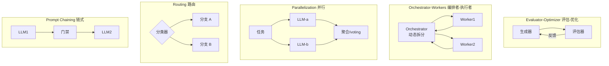

<FreshnessBadge />

# 编排模式

## 一句话理解

编排模式是「如何组织多个 LLM 调用协作」的五种经典拓扑（Anthropic 总结），从简到繁逐级递增自主性——选型的黄金法则是：**能左不右**。

## 五种工作流模式 + Agent

| 模式 | 适用场景 | 典型例子 |
| ---- | -------- | -------- |
| **链式** | 线性管线，每步可检查 | 先生成营销文案 → 再翻译 |
| **路由** | 输入有明显类别，各类处理不同 | 客服分流：退款/咨询/投诉 |
| **并行** | 子任务独立，要提速或要投票 | 多角度评审、批量翻译 |
| **编排者-执行者** | 子任务**无法预先确定**，需动态拆分 | 复杂研究、多文件代码修改 |
| **评估-优化** | 有明确评价标准、生成质量可迭代 | 文学翻译润色、搜索优化 |
| **Agent（自主循环）** | 开放任务、步数与路径不可预测 | 编码 agent、深度研究 |

## 多智能体协作的组织形态

当「编排者-执行者」里的 worker 本身也是 agent 时，就进入多智能体领域。常见拓扑：

- **Supervisor 型**（主流）：一个主 agent 拆解分派，sub-agent 干完汇报。LangGraph/CrewAI 的默认模式，可控性最好。
- **去中心化型**：agent 间点对点对话协商（AutoGen 对话式、A2A 协议的目标场景）。灵活但难调试，token 消耗易失控。
- **流水线型**：按 SOP 固定角色顺序传递（MetaGPT 的软件公司隐喻）。

**什么时候真的需要多 agent？** 只有两个硬理由：① 上下文隔离（各分支在不同窗口工作，见[上下文工程](/learn/foundations/context-engineering)）；② 并行加速。**「多个角色开会讨论」本身不产生智能**——Anthropic 的经验：他们的多 agent 研究系统 90% 的提升来自 sub-agent 并行检索带来的上下文隔离，而非「讨论」。

## 我的实践笔记

- 主 agent + sub-agent 的信息回传要设计「汇报 schema」，自由文本汇报会污染主窗口。
- 多 agent 系统调试三件套：每 agent 独立 trace、消息瀑布日志、单元测试跑单个 agent。

## 参考资料

- [Anthropic: Building Effective Agents](https://www.anthropic.com/research/building-effective-agents)（五种模式的原始出处）
- 站内：[多智能体系统方向](/frontier/directions/multi-agent)、[A2A 协议](/frontier/protocols/a2a)
