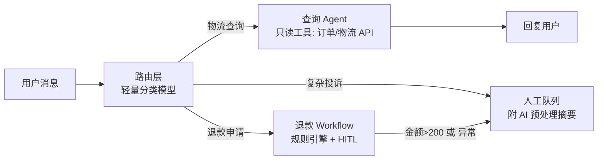

<FreshnessBadge />

# 示例：客服 Agent 落地

> ⚠️ 这是按 `templates/case-study.md` 结构编写的**教学示例**（数据为示意值），展示案例页该怎么写。真实案例请照此结构填入公开报道的数据并附来源。

## 背景

中型电商，日均客服咨询 8000 单：60% 是物流查询、25% 退换货、15% 复杂投诉。人工客服 40 人，高峰响应超 30 分钟。

## 方案架构

关键决策：

- **物流查询用 agent、退款用 workflow**——退款规则明确可编排，不需要模型自由发挥（[什么是 Agent](/learn/foundations/what-is-agent) 的选型原则）；
- 查询 agent 数据库账号**只读**，退款 workflow 有额度白名单（[安全](/learn/engineering/security)的权限层）；
- 全量 trace 进 Langfuse，退款决策 100% 留审计日志。

## 效果数据（示意）

| 指标 | 上线前 | 上线 3 个月 |
| ---- | ------ | ----------- |
| 首响时间 | 28 min | 40 s |
| 人工处理量 | 8000/日 | 1900/日 |
| 退款错误率 | 人工 0.9% | agent 0.6%（HITL 兜底） |
| 每单成本 | ¥4.2 | ¥1.1 |

## 踩过的坑

1. 早期把退款也做成自由 agent——模型「善意」超范围补偿，两周损失失控；改为规则 workflow 后解决。
2. 工具返回全量订单 JSON 灌爆上下文；裁剪为摘要 + 详情按需查询后成本降 60%。
3. 大促期间上游 API 变慢，agent 反复重试放大故障；加退避和降级话术后恢复。

## 关键启示

1. **按任务形态选自主级别**：明确流程给 workflow，开放任务才给 agent；
2. 权限最小化 + HITL 分级不是合规装饰，是防止财务事故的核心；
3. 工具返回值治理是性价比最高的优化。

## 来源

- 教学示例，无外部来源；真实案例参考 [Salesforce Agentic Enterprise Index](https://www.salesforce.com/news/stories/agentic-enterprise-index-insights-2026/)
